# Work 1 — Secure REST API Development with CI/CD and Real CVE Analysis

**Student:** Kong Mingzhe · **HDU number:** 23320223 · **Variant:** N/A

## Project

A small Python 3 / Flask REST API with SQLite, signed JWT bearer tokens, scrypt password hashes, parameterized SQL, and output escaping. It is an educational example and is not production-hardened.

### Run locally

```sh
python3 -m venv .venv
source .venv/bin/activate
python -m pip install -r requirements-dev.txt
export JWT_SECRET="$(python -c 'import secrets; print(secrets.token_urlsafe(48))')"
python app.py
```

The first run creates `app.db` and a lab-only account: `student / ChangeMe123!`. The API binds to loopback (127.0.0.1) by default; do not expose the sample account or service to a shared network.

### API

| Method | Path | Authentication | Description |
| --- | --- | --- | --- |
| POST | `/auth/login` | None | JSON `{"login":"student","password":"ChangeMe123!"}`; returns a short-lived JWT on success |
| GET | `/api/data` | Bearer JWT | Returns posts; responds 401 without a valid token |
| POST | `/api/posts` | Bearer JWT | Creates a post from `{"title":"…","body":"…"}` |
| GET | `/health` | None | Liveness response |

Example:

```sh
curl -i http://127.0.0.1:5000/api/data
curl -sS -X POST http://127.0.0.1:5000/auth/login \
  -H 'Content-Type: application/json' \
  -d '{"login":"student","password":"ChangeMe123!"}'
# Copy access_token from the JSON response into TOKEN before the next request.
curl -i http://127.0.0.1:5000/api/data -H "Authorization: Bearer $TOKEN"
```

## Step-by-step work evidence

The screenshots below follow the order used to build and verify the project. They are stored in `evidence/` so the README images remain available in the repository.

### Step 1 — Prepare the environment and repository

This screenshot records the starting project environment and Git setup.

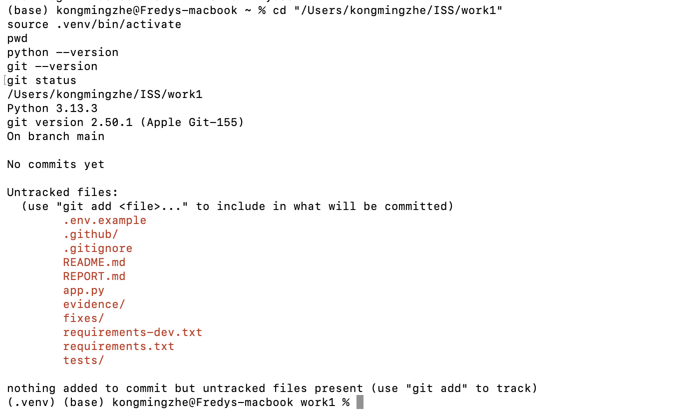

### Step 2 — Run the API tests

The initial test run checks the API behavior before demonstrating requests manually.

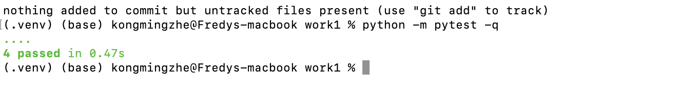

### Step 3 — Start the API server

The server runs locally on `127.0.0.1:5000` for the request demonstrations.

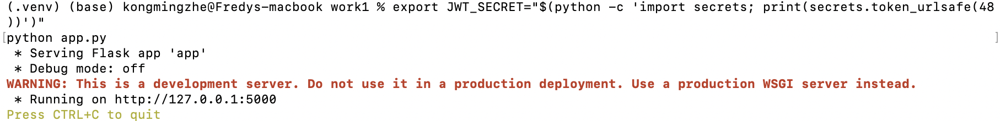

The following screenshot also captures the test and server output together:

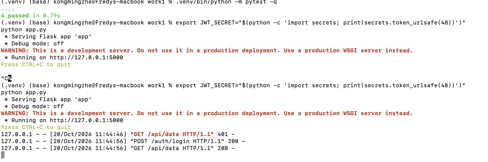

### Step 4 — Confirm anonymous requests are rejected

An unauthenticated request to the protected API endpoint should receive an unauthorized response.

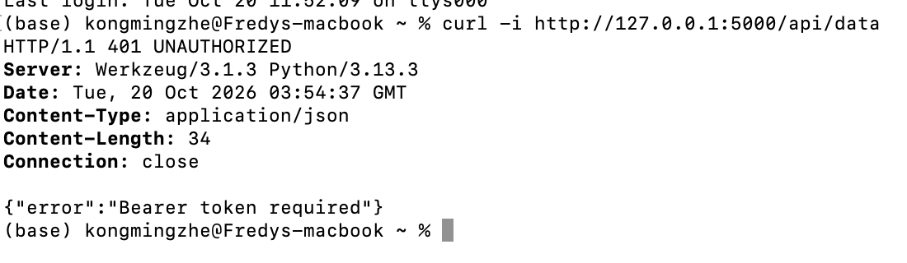

### Step 5 — Log in and access protected data

After login, the client sends the returned bearer token to access the protected data endpoint.

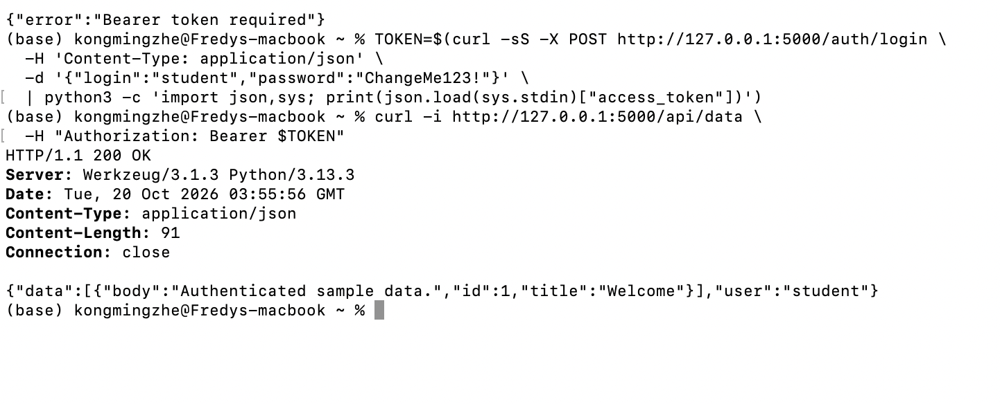

This screenshot provides additional authentication-flow evidence:

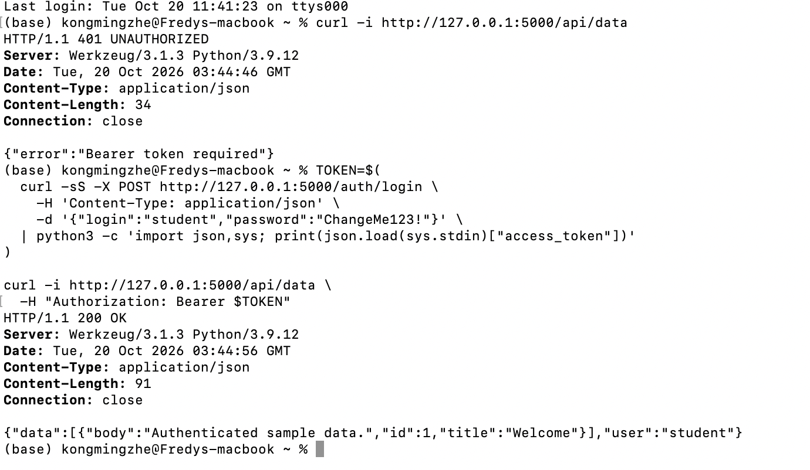

### Step 6 — Create and retrieve a post

The authenticated client creates a post and then reads it back from the API.

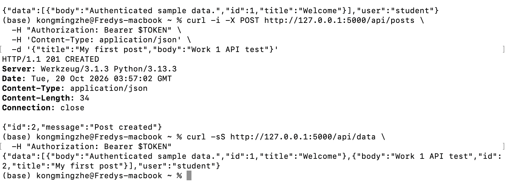

### Step 7 — Run tests and dependency checks locally

These screenshots document the local test and audit results at two points in the work.

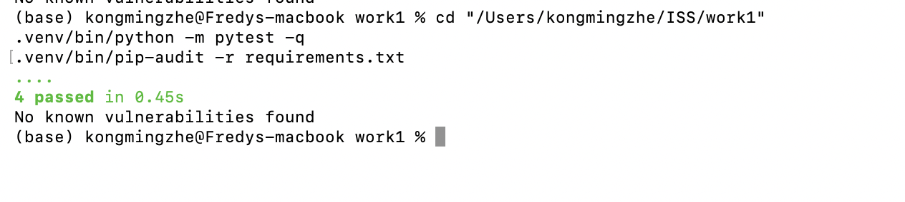

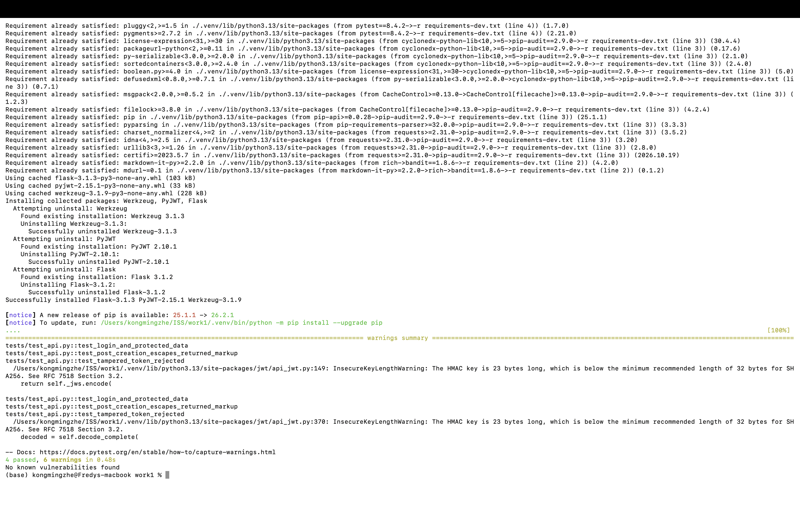

### Step 8 — Commit the completed work

The local Git commit records the implementation in the repository history.

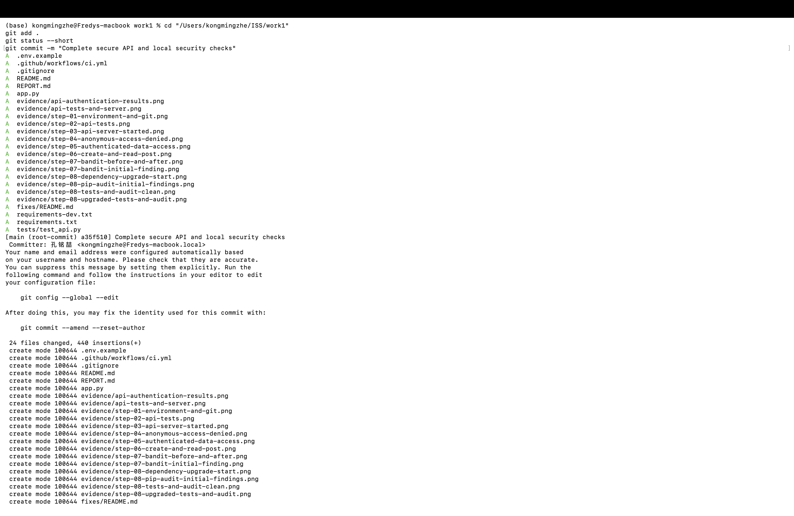

### Step 9 — Check Git identity and remote

This screenshot records the configured Git identity and GitHub remote used for publishing.

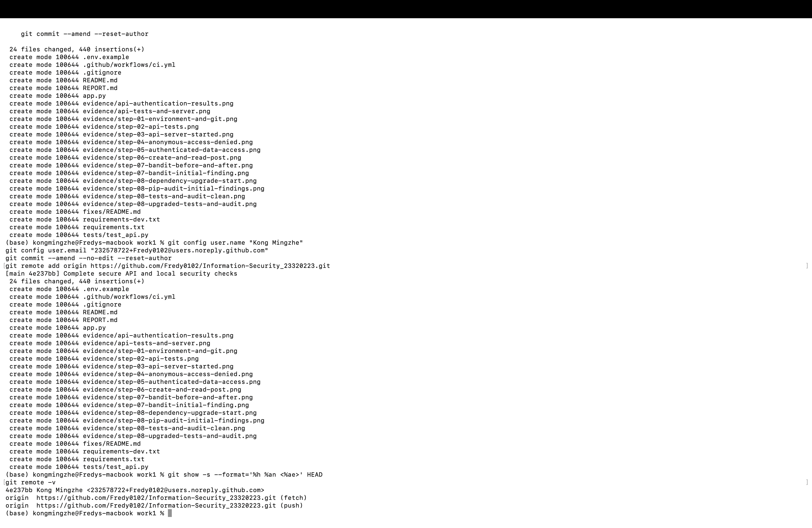

### Step 10 — Verify the automated GitHub Actions workflow

The workflow runs Bandit for static analysis, OWASP Dependency-Check and pip-audit for dependency checks, and pytest. The OWASP GitHub Action is pinned to a full commit SHA and enables Dependency-Check's experimental Python analyzer for `requirements.txt`; its preloaded vulnerability database is used without sending an API key to the scan container. pip-audit remains as a second Python-focused dependency check. All scanner reports are uploaded in the `security-reports` artifact.

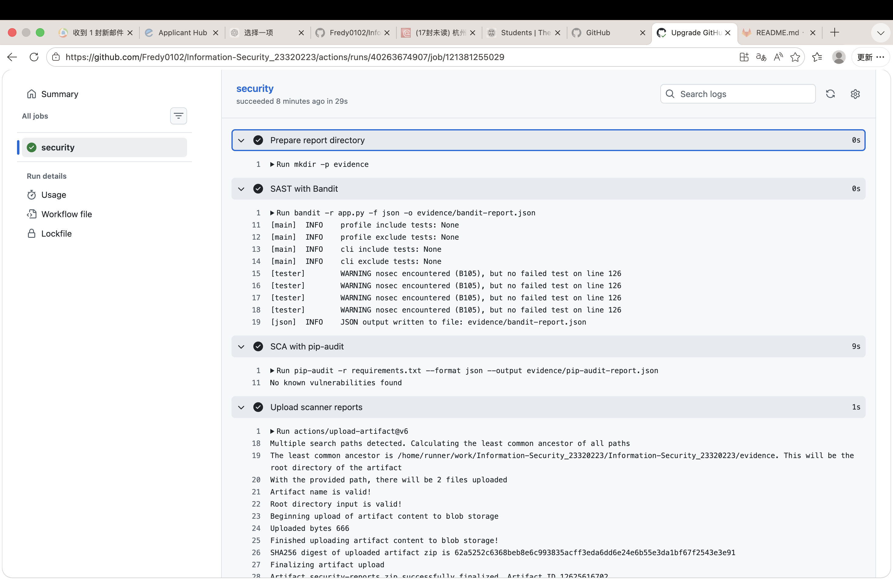

These existing screenshots are from an earlier successful run, before OWASP Dependency-Check was added; they do not prove the new step ran. The updated workflow was verified by [Actions run 40273187698](https://github.com/Fredy0102/Information-Security_23320223/actions/runs/40273187698) on commit `ec1a9d7`. The Dependency-Check, pip-audit, Bandit, API test, and artifact-upload steps all succeeded. Download the `security-reports` artifact from that run to inspect `dependency-check-report.html`.

The next screenshot shows API tests passing in that earlier run.

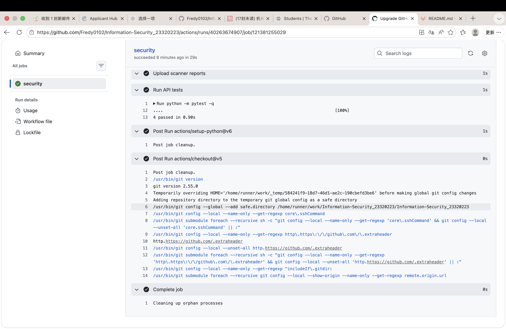

## Security controls

- **SQL injection:** SQLite statements bind values with `?` placeholders. User-controlled values never become SQL syntax.
- **XSS:** API responses are JSON; `title` and `body` are also HTML-escaped before return so a client that renders them as markup receives inert text. Clients should still use safe text APIs and apply context-appropriate encoding.
- **Authentication:** Passwords are stored as Werkzeug scrypt hashes, never plaintext. Login verifies the hash and issues an HS256 JWT with issuer, subject, issue time, and expiration. Middleware requires a Bearer token and verifies signature, issuer, and required claims. JWT secret is read from the environment and startup fails if absent.
- **Input handling:** JSON types and lengths are checked. Debug mode is disabled.

## CI security scanning

GitHub Actions runs Bandit (SAST), OWASP Dependency-Check and pip-audit (SCA), and pytest on every push and pull request. It uploads the Bandit JSON, pip-audit JSON, and Dependency-Check HTML report as the `security-reports` artifact. Dependency-Check uses its experimental Python analyzer, enabled explicitly for the pinned `requirements.txt`; pip-audit remains as a complementary Python SCA check. [Actions run 40273187698](https://github.com/Fredy0102/Information-Security_23320223/actions/runs/40273187698) succeeded on commit `ec1a9d7`, including both SCA scans, Bandit, all 4 API tests, and artifact upload. The checked-in screenshots show a previous successful run and predate Dependency-Check; use the linked run and artifact as evidence for the new scanner.

## CVE study: CVE-2018-10933

The practical comparison uses libssh 0.8.1 (vulnerable) and 0.8.4 (fixed). The flaw is an SSH server authentication bypass: a vulnerable server may accept a client-sent authentication-success message before credentials are checked. In the isolated local lab, the vulnerable instance allowed the proof to run the harmless `id` command as container root; the 0.8.4 instance rejected the bypass before a command channel opened. Both ports bind only to `127.0.0.1`. See the [official libssh advisory](https://www.libssh.org/security/advisories/CVE-2018-10933.txt) and [Vulhub's reproduction](https://github.com/vulhub/vulhub/tree/master/libssh/CVE-2018-10933).

### Reproduce and compare the fixed version

Run these steps from the repository root. They start two disposable containers; Compose publishes both SSH ports on loopback only.

```sh
cd cve-lab/CVE-2018-10933
docker compose up --build -d
docker compose ps
python3 -m venv .venv
source .venv/bin/activate
python -m pip install -r requirements.txt
python verify_local.py --port 2222
python verify_local.py --port 2223
docker compose down --rmi local
```

The first proof targets vulnerable libssh 0.8.1. The second sends the same proof to fixed libssh 0.8.4. The proof code is constrained to `127.0.0.1`, permits only these two ports, sends no credentials, and runs only `id` if a command channel opens. The observed comparison is recorded in [`evidence/CVE-2018-10933-results.md`](evidence/CVE-2018-10933-results.md):

```text
Port 2222 (vulnerable): uid=0(root) gid=0(root) groups=0(root)
Port 2223 (fixed):      Authentication bypass was rejected or the service closed the session: Timeout opening channel
```

The following unedited terminal captures show the containers starting, dependency installation, the vulnerable and fixed version checks, and cleanup. The host-platform warning is informational: Docker ran the vulnerable `linux/amd64` image on the Apple Silicon `linux/arm64/v8` host. Paramiko's TripleDES deprecation message is also a warning; the proof completed and printed the results below.

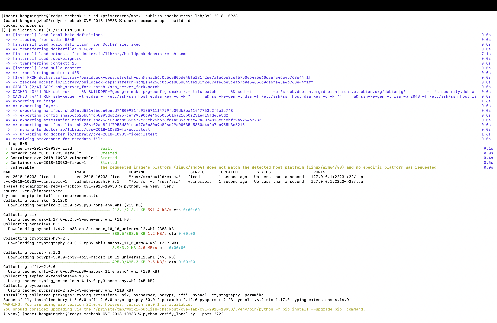

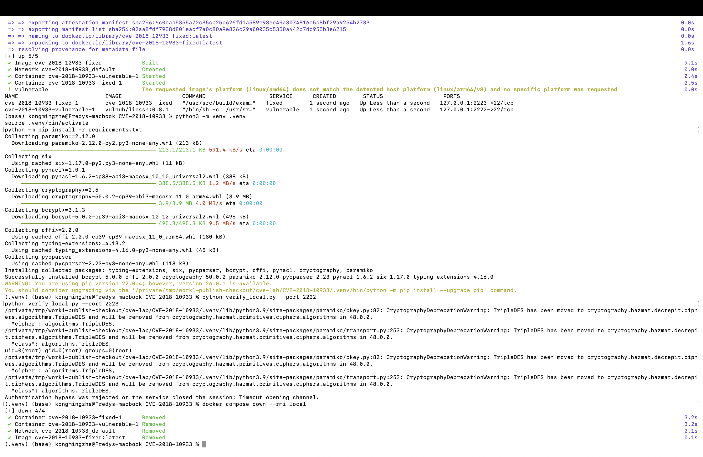

Exact setup and observations are also in [`cve-lab/CVE-2018-10933/README.md`](cve-lab/CVE-2018-10933/README.md).

## Local verification

Run from the repository root:

```sh
python -m pip install -r requirements-dev.txt
python -m pytest -q
bandit -r app.py -f json -o evidence/bandit-report.json
pip-audit -r requirements.txt --format json --output evidence/pip-audit-report.json
python -m pip check
```

On 2026-10-25: 4 pytest tests passed; Bandit reported zero unsuppressed findings (the standard `Bearer` auth-scheme label is explicitly suppressed as a B105 false positive); pip-audit found no known vulnerabilities in the three pinned runtime dependencies; `pip check` found no broken requirements. These are local results, not a claim about the GitHub-hosted workflow.

## Control Questions and Answers

1. **Why is password hashing with algorithms like bcrypt preferable to using SHA-256?**
   SHA-256 is designed to be fast, so an attacker with a stolen password database can test many guesses quickly. Password hashing algorithms such as bcrypt and scrypt are deliberately slower and use a unique salt for each password. This makes offline guessing more expensive and prevents identical passwords from producing identical stored hashes. In this API, passwords are stored with Werkzeug's scrypt-based password hashing.

2. **What is the main difference between SAST and DAST?**
   SAST examines source code without running the application and can identify risky code patterns early. DAST sends requests to a running application and observes its externally visible behavior. In this work, Bandit performs SAST; the ZAP scan of Juice Shop in Work 2 is a DAST exercise.

3. **Describe how a JWT works. What does it contain, and how does the server verify it?**
   A JWT has an encoded header, a claims payload, and a signature. After successful login, the API signs a short-lived token. On protected endpoints, the server verifies the signature with its configured secret and checks claims such as issuer and expiration before returning data. A signed JWT is not encrypted by default, so its payload must not contain secrets.

4. **What risks arise if third-party dependencies are not audited?**
   Direct or transitive packages may contain known vulnerabilities, be abandoned, or introduce supply-chain risks. Without an audit, those issues can remain unnoticed and expose the application to attacks that already have public fixes. The CI workflow uses OWASP Dependency-Check and pip-audit to identify known dependency issues and produce reports.

5. **What advantages do Docker and Vulhub provide for studying cybersecurity compared with installing vulnerable software directly on your machine?**
   Docker and Vulhub provide repeatable, isolated environments with specific software versions and documented steps. This makes vulnerable behavior easier to reproduce and compare with a fixed version, while reducing changes to the host system. Containers can also be stopped and removed after the experiment. The CVE lab in this work bound its services to localhost.

6. **What is the difference between a vulnerability and an exploit? What did you reproduce in this work?**
   A vulnerability is a weakness in software or its configuration; an exploit is a technique that uses that weakness to cause an unintended result. This work reproduced the authentication-bypass behavior of CVE-2018-10933 in the isolated libssh lab: the vulnerable service accepted the proof and opened a channel for a harmless `id` command, while the fixed version rejected it.

7. **Why is regression testing important after applying a security patch?**
   A patch can stop the attack but also unintentionally break legitimate behavior. Regression testing checks both outcomes: the previously successful attack should now be rejected, and normal functionality should continue to work. In this lab, the same proof was tested against the fixed libssh service, and the API test suite checks the expected routes and authentication behavior.

8. **How does reproducing known CVEs help a security specialist, such as a pentester or SOC analyst?**
   A controlled reproduction helps specialists recognize vulnerable versions, connect technical weaknesses to observable evidence, assess impact, and choose an appropriate remediation. It also provides a repeatable way to verify that an upgrade or configuration change works. In practice, these skills support vulnerability triage, incident investigation, and clear communication of risk.

## Submission note

The repository configures both OWASP Dependency-Check and pip-audit. The new Dependency-Check workflow run succeeded: [run 40273187698](https://github.com/Fredy0102/Information-Security_23320223/actions/runs/40273187698). Actual CVE command output is recorded, but CVE terminal screenshots still need to be captured during a run.
